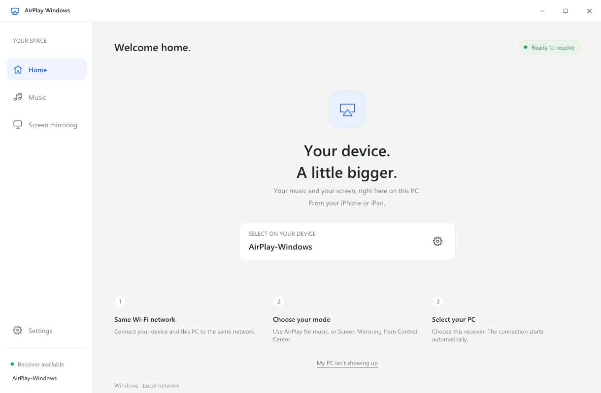

# AirCast Server

**AirCast Server** is a fast, native Windows receiver designed for wireless screen mirroring and audio streaming. Built from the ground up for high-performance low-latency display using DirectX 11 hardware acceleration and native audio playback.



## Overview

AirCast Server turns your Windows PC into a universal casting display:
* **AirPlay 2 (Apple iOS & macOS)**: Screen Mirroring (H.264 & HEVC), low-latency RAOP audio (AAC-ELD / ALAC), and media metadata with album art.
* **Google Cast (ChromeOS & Google Chrome)**: Native Chromecast V2 receiver for Chromebooks and Chrome browser tab/screen casting.
* **Android Cast (Miracast / Wi-Fi Display)**: Wireless Display, Samsung Smart View, and Android screen projection via WFD RTSP.
* **Native Windows Integration**: Built-in Windows firewall detection, single-instance management, and Inno Setup installer.

---

## Getting Started

### Installation
1. Download the latest installer **`AirCast-Server-Setup.exe`** from [Releases](../../releases) or Actions artifacts.
2. Run the setup wizard to install AirCast Server on your PC and create a Desktop shortcut.
3. Launch **AirCast Server**.

### Mirroring from iOS / macOS
1. Connect your PC and mobile device to the same Wi-Fi network.
2. Open **Control Center** on your iPhone/iPad/Mac.
3. Tap **Screen Mirroring** (or AirPlay audio) and select **AirCast Server**.

### Mirroring from Android / ChromeOS / Google Chrome
* **Android (Samsung, Xiaomi, Oppo, Vivo, etc.)**: Open Quick Settings -> Tap **Smart View** or **Wireless Display** -> Select **AirCast Server**.
* **ChromeOS & Google Chrome**: Click the 3-dots menu -> **Cast...** -> Select **AirCast Server** (Cast tab or Cast entire screen).

---

## Features

| Feature | Details |
|---|---|
| **Screen Mirroring** | H.264 & HEVC/H.265 up to 4K 60fps with preserved aspect ratio |
| **GPU Acceleration** | Direct3D11 native decode & render (NVDEC / Intel QuickSync / AMD AMF) |
| **Audio Playback** | Native stereo low-latency output via Windows WASAPI / SDL2 |
| **Screen Controls** | Fullscreen (F11), borderless chromeless mode, manual/automatic rotation |
| **Recording** | Lossless MP4 video recorder with synced stereo audio track |
| **Settings** | Customizable device name, resolution presets, and hardware acceleration toggles |
| **Zero External Runtime** | No Bonjour SDK, no iTunes, and no GStreamer installation required |

---

## Building from Source

### Prerequisites
* Windows 10 (1809+) or Windows 11 x64
* Visual Studio 2022 / 2026 with C++ Desktop Development workload
* CMake 3.21+
* vcpkg

### Compile
```powershell
cmake -S . -B build -DCMAKE_TOOLCHAIN_FILE="$env:VCPKG_ROOT/scripts/buildsystems/vcpkg.cmake"
cmake --build build --config Release
```

---

## License & Acknowledgements

* **License**: Licensed under the [GNU General Public License v3 (GPLv3)](LICENSE).
* **Acknowledgements**:
  - Based on [AirPlay-Windows](https://github.com/moieric11/AirPlay-Windows) by Eric Brignier.
  - Core AirPlay protocol reverse-engineering derived from [UxPlay](https://github.com/FDH2/UxPlay) and [RPiPlay](https://github.com/FD-/RPiPlay).
  - OpenSSL, FFmpeg, SDL2, and libplist project contributors.
